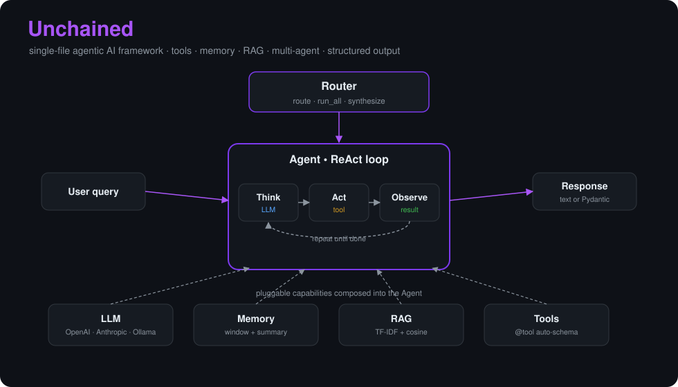

<div align="center">

# ⛓️‍💥 Unchained

**A single-file agentic AI framework.**
Tools, memory, RAG, multi-agent orchestration and structured output — in one file, with two dependencies.

[](https://github.com/NiravRVaghasiya/unchained/actions/workflows/ci.yml)
[](https://www.python.org/)
[](LICENSE)
[](https://mypy-lang.org/)
[](https://github.com/astral-sh/ruff)



</div>

---

## Why Unchained?

Most agent frameworks ask you to learn a mountain of abstractions before you
can print "hello world". Unchained is the opposite: one readable file, two
dependencies, zero magic. Copy the one source file into your project and you
are done.

- **Single-file core** — the whole framework is one file, `unchained/__init__.py`. No submodules to jump between.
- **Two dependencies** — `requests` + `pydantic`. Nothing else.
- **Provider-agnostic** — the same code runs on OpenAI, Anthropic, a local Ollama model, or any OpenAI-compatible endpoint (Groq, Together, OpenRouter, vLLM, LM Studio, ...). Change one line.
- **No magic** — no metaclasses, no monkey-patching, no hidden global state.
- **Composition over inheritance** — an `Agent` is just an `LLM` plus tools, memory and RAG.
- **Governed in Python, not by the prompt** — tool calls are authorized in Python by a policy, tools marked `requires_approval` need a human's approval, budgets bound a run, and sessions isolate conversations. See [Tool authorization](docs/GUIDE.md#tool-authorization), [Run budgets](docs/GUIDE.md#run-budgets) and [Sessions](docs/GUIDE.md#sessions).

## Why I built this

I wanted to understand agentic systems by building one from first principles
rather than wiring together someone else's abstractions. Unchained is the
result: small enough to read in a single sitting, but complete enough to run a
real multi-agent application (see [PickMyStack](examples/pickmystack/)). It
doubles as a readable reference for how tool-calling, retrieval, memory
compression, and multi-agent routing actually work under the hood.

## Install

The framework needs only `requests` and `pydantic`:

```bash
pip install requests pydantic
```

Then take the one source file — that's the point:

```bash
curl -O https://raw.githubusercontent.com/NiravRVaghasiya/unchained/main/unchained/__init__.py
mv __init__.py unchained.py
```

Working on Unchained itself? Clone the repository and install it editable, with
the development extras:

```bash
git clone https://github.com/NiravRVaghasiya/unchained.git
cd unchained
python -m pip install --upgrade pip
pip install -e ".[dev]"
```

The file sits in a directory in this repository only so that `pip install unchained-ai`
can ship a PEP 561 `py.typed` marker, which a type checker will not accept on a
bare top-level module. Dropped into your project as `unchained.py`, it works
exactly the same.

## 30-second tour

```python
from unchained import LLM, Agent, tool


@tool
def add(a: int, b: int) -> int:
    """Add two numbers together."""
    return a + b


agent = Agent(
    LLM(provider="ollama", model="llama3.1"),
    tools=[add],
    system_prompt="You are a precise calculator.",
)

print(agent.run("What is 1234 + 5678?"))
```

Switch to a cloud provider by changing a single argument:

```python
agent = Agent(LLM(provider="openai", model="gpt-4o-mini"), tools=[add])
agent = Agent(LLM(provider="anthropic", model="claude-sonnet-4-6"), tools=[add])
```

For Anthropic, always pass `model=` — see the [Anthropic note](#security-and-limitations).

API keys are read from `OPENAI_API_KEY` / `ANTHROPIC_API_KEY` if you don't pass them explicitly.

### Any OpenAI-compatible endpoint

`provider="openai"` isn't limited to OpenAI itself — pass (or set the env var
for) a different `base_url` and the same code talks to Groq, Together,
OpenRouter, vLLM, LM Studio, or anything else that speaks the OpenAI chat API:

```python
agent = Agent(LLM(provider="openai", model="llama-3.1-70b", base_url="https://api.groq.com/openai"))
```

Or via the environment, with no code change at all:
`OPENAI_BASE_URL`, `ANTHROPIC_BASE_URL`, `OLLAMA_BASE_URL` (see `.env.example`).

## No API key? No problem

`MockLLM` is a deterministic, no-network stand-in for a real provider, so the
examples — and your own tests — run with zero setup:

```python
from unchained import Agent, MockLLM

agent = Agent(MockLLM(reply="Hello from a mock model!"))
print(agent.run("hi"))  # no key, no server, fully offline
```

See the whole loop (tool calling, streaming, structured output) with no setup:

```bash
python examples/quickstart.py
```

Swap `MockLLM(...)` for `LLM(provider=...)` when you're ready for a real model.

## What's inside

Every agent runs the classic ReAct cycle (think, act, observe, repeat) until
the model stops asking for tools. The [Developer guide](docs/GUIDE.md) has the
full reference for each feature below, starting with [the agent loop](docs/GUIDE.md#the-agent-loop).

### Tools and argument validation

`@tool` maps type hints to a JSON schema, including `Literal[...]`, `Enum`
subclasses and nested Pydantic models, and the docstring to the description:

```python
from typing import Literal


@tool
def set_thermostat(mode: Literal["heat", "cool", "off"], degrees: int) -> str:
    """Set the thermostat mode and target temperature."""
```

Arguments are validated against the Python signature and normalised to the
annotated types before the function runs, so an invalid call never reaches it,
and validation errors never repeat the offending value. Tools can be
`async def`. Calls from one turn run concurrently on a capped thread pool
(`Agent(max_tool_workers=8)`), and a `@tool(concurrency="exclusive")` call runs
on its own. More: [Guide - Tools](docs/GUIDE.md#tools)

### Authorization and approval

A model asking for a tool is a *request*, not a decision: tools carry metadata
the model never sees (`permissions`, `requires_approval`, `side_effects`), a
policy such as `PermissionPolicy(granted={"billing:write"})` decides in Python,
and your `approve=` callback, not the model, answers approval requests. Every
call takes one path:
`claim budget → locate tool → validate arguments → policy.authorize() → approval → audit → execute → bound output`.
A refusal comes back to the model as an observation, and a tool that needs
approval with no approver wired up is refused, because an unanswerable
question is a refusal, not a pass. With no `policy=`, the default `ToolPolicy`
allows every tool the agent was given, subject to each tool's own `allowed=`
hook and `requires_approval` flag.
More: [Guide - Tool authorization](docs/GUIDE.md#tool-authorization)

### Run safeguards

`Agent(budget=Budget(...))` bounds a whole run: `max_iterations` forces a
final answer, and `max_tool_calls`, `max_total_tokens`, `max_tool_output`,
`timeout` and `max_cost` raise a `BudgetExceededError` subclass carrying
`.limit_name`, `.limit` and `.used`. Budgets are per run, every model-requested
tool call counts (even unknown and denied ones), and there is no built-in price
table, so `max_cost` needs your `pricing=`. Tool timeouts (`@tool(timeout=10)`,
`Agent(tool_timeout=30)`) bound the wait, not the work: Python cannot cancel a
thread, so a timed-out tool keeps running and its side effects are unknown.
Output limits (`@tool(max_output_size=8_000)`, `Agent(max_tool_output_size=...)`)
truncate a result before it enters memory and add a note saying so; that is a
context and cost boundary, not a sandbox.
More: [Guide - Run budgets](docs/GUIDE.md#run-budgets) · [Tool timeouts](docs/GUIDE.md#tool-timeouts) ·
[Tool output limits](docs/GUIDE.md#tool-output-limits)

### Trust boundaries

Retrieved documents, tool results and the conversation summary are fenced as
data with a random per-agent marker, which is stripped from the text so content
cannot close its own block. **This does not solve prompt injection, and no
system prompt does.** The boundary that holds is the Python policy, which
decides from tool metadata, the arguments and a context built from your code,
never from retrieved or returned text.
More: [Guide - Trust boundaries](docs/GUIDE.md#trust-boundaries)

### Sessions

An `Agent` is configuration (the LLM, tools, prompt and policy); a `Session`
is one conversation's state (its memory, token counters and metadata). Build
the agent once and give each user `agent.session()`, which cannot see another
session's history. `agent.run()` uses one persistent default session, so it
suits single-conversation scripts.
More: [Guide - Sessions](docs/GUIDE.md#sessions)

### Memory

`Memory(max_messages=20, llm=llm)` is a sliding window: when it fills up, the
oldest half is compressed into a running summary so token usage stays
predictable. Add `max_tokens=` to shrink the window further whenever the kept
messages alone would exceed it (estimated at ~4 chars/token, no tokenizer
dependency). [`examples/sqlite_memory.py`](examples/sqlite_memory.py) has a
`SQLiteMemory` that survives restarts.
More: [Guide - Memory](docs/GUIDE.md#memory) · [Persistent memory](docs/GUIDE.md#persistent-memory)

### RAG

`RAG()` is TF-IDF with smoothed (sklearn-style) IDF and cosine similarity,
entirely in memory; `RAG(embed_fn=...)` uses dense embeddings instead. Fill it
with `rag.add_many(texts, metadatas)` and pass `Agent(llm, rag=rag)`; metadata
comes back with every hit. Inputs are validated, and nothing is stored until
all of it validates. There is no chunking, metadata filtering or persistence,
and scoring is a linear scan: fine for a few thousand chunks, not a vector
database. More: [Guide - RAG](docs/GUIDE.md#rag)

### Structured output

`agent.run(prompt, response_format=Recipe)` returns a real, validated instance
of the Pydantic model `Recipe`. If the model's JSON fails validation, the agent
feeds the error and schema back and asks it to fix the output before giving up
(`structured_retries`).
More: [Guide - Structured output](docs/GUIDE.md#structured-output)

### Multi-agent

`Router(llm, agents=[...], synthesizer=synth)` can `run()` a query on one routed
agent in a fresh session, `run_all()` every agent in parallel, or
`synthesize()`: run all, then fuse. **Routing fails closed**: the decision is
asked for as JSON and checked against the registry in Python, and only a JSON
decision (`{"agent": "cost"}`) or a bare agent name that identifies exactly one
registered agent resolves. Anything else, including prose naming one agent,
raises `RoutingError`, unless you name a default with `fallback=triage_agent`.
More: [Guide - Multi-agent routing](docs/GUIDE.md#multi-agent-routing)

### Streaming, async and events

`agent.stream(prompt)` resolves tool calls first, then streams the final answer
token by token. `await agent.arun(prompt)` keeps an event loop responsive by
running the synchronous call on a worker thread (`asyncio.to_thread`); it is
not a non-blocking async HTTP client. Watch a run with `Callback` subclasses,
`agent.subscribe(...)` for `AgentEvent` records carrying `run_id` and
`session_id`, or `agent.events(...)` to iterate the whole lifecycle. **Event
payloads are excluded by default** (prompts, arguments, results and answers
appear as shapes and sizes) unless you pass `Agent(event_payloads=True)`;
`LoggingCallback` is a verbatim development tracer, and `events()` yields the
streamed text and the answer in full to its one consumer.
More: [Guide - Streaming](docs/GUIDE.md#streaming) · [Async](docs/GUIDE.md#async) · [Observability](docs/GUIDE.md#observability)

### Providers, retries and caching

Every provider's reply becomes the same `LLMResponse` (`content`, `tool_calls`,
`usage`, `finish_reason`, `provider`, `model`, `request_id`, `metadata`), and a
cut-off answer shows as `finish_reason == "length"` with `response.truncated`
True. Rate limits, `5xx` and dropped connections are retried with exponential
backoff and jitter, honouring `Retry-After`. Response caching is opt-in, and
`cache=True` means `"final_only"`: plain answers are stored and tool-call
responses are never kept; `cache="all"` also caches tool-call decisions and is
only for when every tool in play is read-only.
More: [Guide - Provider responses](docs/GUIDE.md#provider-responses) · [Retries](docs/GUIDE.md#retries) · [Response caching](docs/GUIDE.md#response-caching) ·
[Connection reuse](docs/GUIDE.md#connection-reuse) · [Token usage](docs/GUIDE.md#token-usage)

## Examples

| Example | What it shows |
|---|---|
| [`examples/quickstart.py`](examples/quickstart.py) | Zero-setup tour (no API key) using `MockLLM` |
| [`examples/researcher.py`](examples/researcher.py) | A web-research agent with a search tool |
| [`examples/coder.py`](examples/coder.py) | Runs Python in an isolated subprocess with a timeout (not a full sandbox) |
| [`examples/data_analyst.py`](examples/data_analyst.py) | CSV analysis with a stats tool |
| [`examples/sqlite_memory.py`](examples/sqlite_memory.py) | Persistent, session-scoped memory backed by SQLite |
| [`examples/policy.py`](examples/policy.py) | Read-only, side-effecting and approval-required tools under a `ToolPolicy` |
| [`examples/sessions.py`](examples/sessions.py) | One agent serving many users concurrently, one `Session` each |
| [`examples/pickmystack/`](examples/pickmystack/) | **Flagship** multi-agent app that recommends an AI stack |

### PickMyStack

The flagship demo. Describe your use case and constraints; three specialist
agents (cost, fit, trend) evaluate options in parallel and a synthesizer ranks
the top stacks. Ships with a CLI and a Streamlit UI (the UI needs
`pip install streamlit`).

```bash
python -m examples.pickmystack.app "Build a customer-support chatbot" --budget 200 --team 3
# or launch the web UI:
streamlit run examples/pickmystack/ui/app_ui.py
```

## Security and limitations

Unchained enforces real boundaries in Python — a policy decides whether a tool
runs, arguments are validated against the signature, retrieved and returned
text is fenced as data, and budgets stop a runaway loop. None of that makes it
a sandbox, and the README would be misleading if it implied otherwise:

- **Tools run in your process, with your process's privileges.** A tool is an
  ordinary Python function called in-process. It can read what your process
  can read, open sockets, and spawn processes. Installing a tool is trusting
  code, exactly like adding a dependency.
- **Prompt injection is not solved.** Retrieved documents and tool results are
  fenced and marked as data, and the system prompt says so — but a persuasive
  document can still talk a model into asking for the wrong thing. What
  contains it is that a `ToolPolicy` decides in Python what may run, from
  metadata fixed at decoration time.
- **Nothing here restricts network access.** A tool that fetches a
  model-supplied URL will reach `localhost` and internal hosts. Validate URLs
  and pass an explicit `timeout=` inside the tool.
- **Running untrusted code needs external isolation** — a container, seccomp,
  egress rules. [`examples/coder.py`](examples/coder.py) uses an isolated
  subprocess and says plainly that this is a demo, not a sandbox.
- **A tool timeout bounds the wait, not the work.** Python cannot cancel a
  running thread, so after a timeout on a side-effecting tool, treat the effect
  as unknown rather than as not having happened.
- **Anthropic models: always pass `model=`.** Without it, `LLM(provider="anthropic")`
  still defaults to `claude-3-5-sonnet-20241022`, retired on Oct 28, 2025.
  Claude 4.7 and later models reject the `temperature` Unchained always sends
  (default 0.7): use a Claude 4.6 model such as `claude-sonnet-4-6`, or
  `temperature=1` on Claude Sonnet 5.5 or Haiku 5.5, which accept only that
  default value. Claude Opus 5.5 rejects `temperature` entirely, so it does not
  work with Unchained yet.

**[SECURITY.md](SECURITY.md)** has the full threat model, the trust ladder over
the five sources of text, what is enforced in code, what deliberately is not,
and a production checklist. Read it before putting an agent in front of
anything that matters.

## Documentation

- **[API reference & docs site](https://niravrvaghasiya.github.io/unchained/)** — built with MkDocs (`pip install -e ".[docs]" && mkdocs serve`)
- [Developer guide](docs/GUIDE.md) — the full reference for every feature
- [Architecture](docs/ARCHITECTURE.md) — how every piece fits together
- [User Manual](docs/USER_MANUAL.md) — a friendly, non-technical guide
- [Contributing](CONTRIBUTING.md) · [Changelog](CHANGELOG.md) · [Security policy](SECURITY.md)

## Development

```bash
pip install -e ".[dev]"

ruff check .            # lint
ruff format --check .   # formatting
mypy                    # type-check the core
pytest --cov=unchained  # tests + coverage
```

The test suite uses a fake LLM, so it runs fully offline with no API keys. CI
runs the tests on Python 3.9–3.13, and ruff, ruff format and mypy on 3.12, on
every pull request and on pushes to `main`. The wheel-based packaging tests
(which check that the built wheel ships `py.typed`) need the `build` module
(`pip install -e ".[dev]"`) and are skipped without it, so CI, which installs
only `.[test]`, skips them. See
[CONTRIBUTING.md](CONTRIBUTING.md) to get started.

## Extending

Unchained is designed to be extended, not forked — see
[Extension points](docs/ARCHITECTURE.md#extension-points) for each supported
route: new tools, providers, retrieval, memory, tracing, authorization and
routing.

## License

[MIT](LICENSE)
